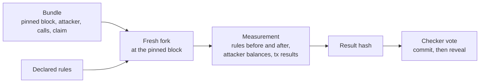

# sapper-replay

The reproduction format and deterministic replay engine behind Sapper findings.

When a Sapper agent finds a way to break a contract, it writes the attempt down as a **bundle**: an ordered list of transactions sent from a fresh, unprivileged account on a fork pinned to one block. Staked Checkers replay that bundle independently with this engine. Because every replay starts from the same pinned state and measures the same things, honest Checkers arrive at the same result hash, and only a bundle that really breaks a rule can be confirmed.

This repository is everything a Checker needs, and everything a protocol team needs to verify a disclosed finding on their own machine.



## Install

Requires [Bun](https://bun.sh) 1.3 or later and [Foundry](https://getfoundry.sh) (for `anvil`).

```sh
git clone https://github.com/sapper-agents/sapper-replay
cd sapper-replay
bun install
```

## Verify a finding

```sh
bun src/cli.ts replay --bundle bundle.json --rules rules.json --rpc https://your-archive-node
```

The command forks the chain at the bundle's block, replays it and prints the measurement:

```json
{
  "confirmed": true,
  "reason": "rule assets-floor broken",
  "resultHash": "0x…",
  "measurement": { "attackerFresh": true, "privileged": false, "rules": [], "balances": [], "txs": [] }
}
```

The exit code is `0` when the claim is confirmed and `2` when it is not. The RPC must serve historical state for the pinned block.

To prepare a Checker vote, add `--finding <id> --checker <address> --salt <32 bytes>` and the output includes the commitment that `SapperCheckerNet.commit` expects.

To compute the rules root you register on chain:

```sh
bun src/cli.ts root --rules rules.json
```

## Formats

### Rules

Each rule compares two operands. An operand is a view call or a constant.

```json
{
  "id": "assets-floor",
  "description": "Vault assets never fall below the 12 ETH reserve",
  "lhs": { "call": { "target": "0x…", "fn": "totalAssets() view returns (uint256)", "args": [] } },
  "op": ">=",
  "rhs": { "const": "12000000000000000000" },
  "severity": "High"
}
```

`op` is one of `==`, `!=`, `>=`, `<=`, `>`, `<`. A call that reverts counts as a broken rule. The rules root is a sorted-pair keccak Merkle root over the keccak hash of each rule's canonical JSON (keys sorted, addresses lowercased), which is the layout OpenZeppelin's `MerkleProof` verifies.

### Bundle

```json
{
  "version": 1,
  "chainId": 4663,
  "target": "0x…",
  "forkBlock": 117461535,
  "attacker": "0x…",
  "calls": [
    { "to": "0x…", "data": "0x…", "value": "0" },
    { "create": "0x6080…", "data": "0x", "value": "1000000000000000000" }
  ],
  "claim": { "kind": "invariant", "invariantId": "assets-floor" }
}
```

- `attacker` must have no transactions and no code at `forkBlock`, and must hold no owner, admin or default admin role on the target.
- The attacker starts with 1,000 ETH for gas and value, and nothing else. Every other asset has to be obtained inside the bundle.
- Each call is one transaction; call `i` is sent with nonce `i`. At most 24 calls.
- `claim` is either a declared rule that held before the bundle and fails after it, or `{ "kind": "balance", "token": "eth" | "0x…" }`: the attacker ends with more of that asset than it started with.

### Measurement and result hash

The engine records the attacker's freshness and privileges, each transaction's status and gas, every rule before and after, and the attacker's balance of ETH and each watched token. Gas price and base fee are zero on the fork, block timestamps advance one second per block from the pinned block, so the measurement is identical on every machine. The result hash is the keccak hash of its canonical JSON.

## Use as a library

```ts
import { fork, replay, resultHash, bundle } from "@sapper-agents/replay";

const lab = await fork({ upstream: process.env.RPC_URL!, block: b.forkBlock, chainId: b.chainId });
const measurement = await replay(lab, bundle.parse(b), rules, watchTokens);
console.log(measurement.confirmed, resultHash(measurement));
await lab.stop();
```

## Tests

```sh
bun run fixtures   # compiles the test contracts with Foundry
bun test
bun run typecheck
```

The suite seeds ten deliberately vulnerable contracts covering common bug classes (a re-runnable initializer, an unprotected setter, reentrancy, unbacked redemptions, signature replay, an unchecked underflow, an arbitrary external call, an unauthenticated delegatecall, a spot-price oracle and an upgrade that drops an access check) and checks that each reproduces from a fresh account, that replay is deterministic across forks, and that privileged accounts and no-op bundles never confirm. These contracts exist only for testing. Never deploy them.

## Related

- [sapper-contracts](https://github.com/sapper-agents/sapper-contracts): the on-chain registry, bounty pot, Checker network and settlement gate.
- [sapperagents.com](https://sapperagents.com)

## License

MIT. See [LICENSE](LICENSE).
